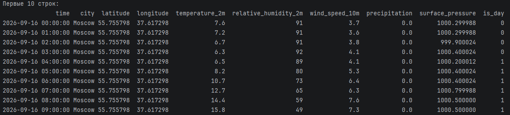
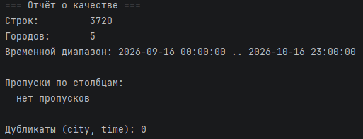

# Источник данных: Open-Meteo

**Платформа:** [Open-Meteo](https://open-meteo.com/)
**Эндпоинт:** `https://api.open-meteo.com/v1/forecast`
**Метод:** HTTP GET, JSON-ответ
**API-ключ:** не требуется
**Лицензия данных:** [CC BY 4.0](https://creativecommons.org/licenses/by/4.0/)

## Что собираем

Почасовую погоду за последние **30 дней** в 5 городах.

Все метки времени — в **UTC**. Так города можно корректно сопоставлять
друг с другом: `14:00` в Moscow и `14:00` в Tokyo соответствуют одному
и тому же моменту физического времени.

Прогнозные значения не собираем: в запросе явно указано
`forecast_days=1` (минимум, разрешённый API), чтобы в датасет
попадали только наблюдения, без примеси прогноза.

| Город | Широта | Долгота |
|---|---|---|
| Moscow | 55.7558 | 37.6173 |
| Saint Petersburg | 59.9311 | 30.3609 |
| Berlin | 52.5200 | 13.4050 |
| Tokyo | 35.6762 | 139.6503 |
| New York | 40.7128 | −74.0060 |

## Переменные и типы

| Поле | Тип | Описание |
|---|---|---|
| `time` | `datetime64[ns]` | момент наблюдения (UTC) |
| `city` | `category` | город |
| `latitude` / `longitude` | `float32` | координаты |
| `temperature_2m` | `float32` | температура на 2 м, °C |
| `relative_humidity_2m` | `Int8` | влажность, % (nullable) |
| `wind_speed_10m` | `float32` | скорость ветра на 10 м, км/ч |
| `precipitation` | `float32` | осадки, мм |
| `surface_pressure` | `float32` | давление, гПа |
| `is_day` | `Int8` | 1 = день, 0 = ночь (nullable) |

## Как запустить

```bash
pip install -r requirements.txt
python scripts/read_api.py
```

Скрипт сохраняет результат в `data/weather_hourly.parquet`.
Папка `data/` в `.gitignore` — данные в репозиторий не попадают.

## Скриншоты

### Первые строки датасета



### Отчёт о качестве

!

## Воспроизводимость

- Один HTTP-запрос на город (5 запросов за прогон).
- Повторные попытки при сетевых ошибках: 3 попытки с экспоненциальной
паузой 2 → 4 → 8 секунд. Ловятся только requests.RequestException,
чтобы не маскировать ошибки в собственном коде. 
- Лимит Open-Meteo для non-commercial использования: до 10 000 запросов
в сутки. 
- Данные распространяются под лицензией CC BY 4.0 — при публикации
результатов нужна ссылка на open-meteo.com. 
- Типы приведены: datetime64[ns], category, float32, Int8,
Int8 (nullable). 
- Сохранение в Parquet (pyarrow) — компактно и без потери типов. 
- После сборки печатается отчёт о качестве: число строк, городов,
временной диапазон, пропуски по столбцам, дубликаты по (city, time).